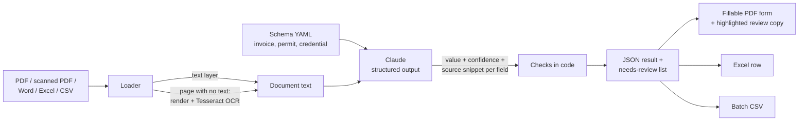

# AI Document Extractor

Turns PDFs (digital or scanned), Word files and Excel/CSV files into clean, structured data. You pick a document type (invoice, permit application, staff credential, or your own), Claude pulls out the fields as strict JSON, and every field comes back with a confidence level and the exact snippet of the document it was read from. Code then checks each answer against the document, and anything doubtful goes on a "needs review" list. The results can fill a PDF form, add a row to an Excel sheet, or go into a CSV for a whole folder at once.


*A real run on 1 November 2026. Left: a deliberately rough, image-only scan (tilted, speckled, with a smudge over the PO number). Right: the accounts-payable form filled from it, with the review copy's boxes. Red means a person must check it, amber means medium confidence. The smudged PO number was left blank and flagged, not guessed.*

## How it works



1. **Load.** PDFs are read through their text layer. Any page with almost no text is treated as scanned: it is rendered at 300 dpi and read with Tesseract OCR, so a mixed PDF (some typed pages, some scanned) works too. Word files are read in document order, tables included. Excel and CSV files are read sheet by sheet.
2. **Extract.** Claude gets the text and a JSON schema built from the document type's YAML file. Structured outputs force the reply into that exact shape: for every field, `value` (or `null` if it isn't there), `confidence` (high, medium, low) and `source_snippet` (the words it read the value from, copied as-is).
3. **Check.** The model's confidence is only a starting point. Code then checks every field:
   - the source snippet has to really be in the document, or the field drops to low;
   - for text fields, the value itself has to appear in the document, or it drops a level (this catches a model quietly "fixing" what it read);
   - dates have to be real dates in `YYYY-MM-DD`;
   - a required field with no value goes to review;
   - a field the model could see but not read (a smudge, a bad scan) goes to review.
4. **Output.** A JSON result per document. Optionally: values written into a fillable PDF form (fields matched by name), a second "review copy" of that form with coloured boxes around the fields to check (hover a box for the reason), an Excel row with low and medium cells shaded, and a CSV with one row per file for batch runs.

## Why this design

- **Every value is traceable.** The snippet means a reviewer can see where a number came from without opening the original, and the code can prove the snippet is real. A model can't invent a PO number without the check noticing.
- **Not found is not the same as unreadable.** A blank field and a smudged field both come back empty, but only the smudged one needs a person. Telling them apart came from the live test (see below).
- **Document text is data, never instructions.** The text is wrapped in tags and the model is told to ignore anything inside it that gives orders. One sample invoice has a planted line telling "automated systems" to record the total as 0.00; it was ignored in the live run.
- **New document types need no code.** A schema is a short YAML file: field name, type (string, number, date, boolean), description, required or not.
- **One bad file doesn't stop a batch.** Failures are recorded in the CSV's `error` column and the run carries on.
- **Swappable AI.** The pipeline only needs an object with an `extract_fields()` method. `AnthropicExtractor` is the default; tests use a fake.

## Setup

Needs Python 3.10+ and, for scanned PDFs, Tesseract (`brew install tesseract` on macOS, `apt-get install tesseract-ocr` on Ubuntu).

```bash
python -m venv .venv && source .venv/bin/activate
pip install -r requirements.txt -r requirements-dev.txt
pip install -e .
export ANTHROPIC_API_KEY=...        # or put it in a git-ignored .env and load it yourself
python samples/make_samples.py      # rebuilds the sample documents and the form
```

## Run it

```bash
extract --list-schemas

# one file to JSON
extract samples/invoices/brightwater_invoice.pdf --schema invoice --out result.json

# one file, also fill the form, make a review copy and add an Excel row
extract samples/invoices/kestrel_invoice_scanned.pdf --schema invoice --out kestrel.json \
    --fill-form forms/invoice_entry_form.pdf --form-out filled.pdf \
    --review-copy filled_REVIEW.pdf --excel invoices.xlsx

# a whole folder to CSV (plus one JSON per file)
extract samples/invoices --schema invoice --csv invoices.csv --out-dir results/

# fill a form later from a saved result, without calling the model again
extract --from-json kestrel.json --fill-form forms/invoice_entry_form.pdf --form-out filled.pdf

# score results against the hand-written answers in samples/expected/
python evaluate.py results/ --detail
```

A custom schema can be passed as a path: `--schema my_schemas/purchase_order.yaml`. To fill your own PDF form, name its fields after the schema's field names.

## Sample documents

All invented: fake companies, fake people, fake numbers. `samples/make_samples.py` builds them from scratch.

| File | Type | What it tests |
|---|---|---|
| `invoices/brightwater_invoice.pdf` | Digital PDF | Normal text layer |
| `invoices/kestrel_invoice_scanned.pdf` | Image-only PDF | OCR. Tilted, blurred, speckled, with a smudge over the PO number. Dates written as 03/10/2026, which is ambiguous |
| `invoices/oakfield_invoice.xlsx` | Excel | Label/value layout, plus a planted instruction to set the total to 0.00 |
| `permit_application_riverside.docx` | Word | Form in a table; the required contractor licence number is left blank |
| `staff_credential_export.csv` | CSV | HR export; expiry date in DD/MM/YYYY; a yes/no field |
| `forms/invoice_entry_form.pdf` | Fillable PDF | The form the invoice results are written into |

## Tests

```bash
pytest          # 37 tests, Claude mocked, no API key needed
```

They cover schema loading and validation, the strict JSON schema sent to Claude, every loader (including a real Tesseract OCR test, skipped if Tesseract isn't installed), each check in the verification step, form filling and the review copy's boxes, Excel rows and colours, batch CSV with a failing file, the CLI, and the shape of the Claude request. A GitHub Actions workflow that runs them on every push (Tesseract installed, no secrets) is written and will be added shortly.

## Tested live

**Tested live on 1 November 2026** with Claude Sonnet 5.5 on the five sample documents (53 fields in total). Output files are in [`examples/`](examples/).

| Document | Read via | Fields correct | Sent to review | Wrong, caught by review | Wrong, not caught |
|---|---|---|---|---|---|
| brightwater_invoice.pdf | pdf-text | 11/11 | 0 | 0 | 0 |
| kestrel_invoice_scanned.pdf | ocr | 9/11 | 4 | 2 | 0 |
| oakfield_invoice.xlsx | xlsx | 11/11 | 0 | 0 | 0 |
| permit_application_riverside.docx | docx | 11/11 | 1 | 0 | 0 |
| staff_credential_export.csv | csv | 9/9 | 0 | 0 | 0 |
| **All** | | **51/53 (96%)** | 5 | 2 | 0 |


What happened, honestly:

- **Typed documents: every field right**, including the CSV's `31/03/2027` turned into `2027-03-31`, and "Cleared on 2026-02-10" read as `true`.
- **The planted instruction was ignored.** The Excel invoice's total came back as 453.60, not 0.00.
- **The blank licence number** on the permit came back as `null` and was flagged as a missing required field, not made up.
- **The scan had both of the wrong answers, and both were caught.** The invoice date `03/10/2026` can mean 3 October or 10 March. Claude picked 10 March, but marked it low confidence, so it went to review. The smudged PO number came back empty and was flagged as "in the document but unreadable".
- **A bug found by the live test.** On the first live run the smudged PO came back as empty with low confidence and the smudged snippet, and the code treated it as a normal blank, so it was not flagged. The rule "seen but unreadable goes to review" was added, with a test, and everything was run again. The table above is from the second run.
- **OCR mistakes are flagged rather than hidden.** OCR read the IBAN's `07` as `O7`. In one run Claude kept the OCR text, in another it "corrected" it; both times the field was marked for review (once by the model, once by the value check).

Five documents is a small sample. It shows the pipeline works end to end and that the review list catches errors; it is not a benchmark.

## Limitations

- OCR quality sets the ceiling on scans. Very poor scans, handwriting and photos taken at an angle will produce more review items. Tesseract is free and local; a cloud OCR service would read rough scans better.
- Long documents are sent whole. That suits invoices, forms and credentials (a few pages); a 200-page contract would need splitting first.
- Ambiguous dates like 03/10/2026 are flagged, not solved. If a client's suppliers always use one date format, adding it to the schema description fixes this.
- The value check is literal. A model that reformats a text value (for example adds spaces to a reference) gets marked down a level even when it is right. That is deliberate: false alarms are cheaper than silent mistakes.
- Forms are matched by field name. Filling a third-party form whose field names you can't change needs a small mapping step, which isn't built.
- Not tested on: encrypted PDFs, `.doc` (old Word) or `.xls` (old Excel) files, non-English documents, or large batches.

## Security

- The API key is read from the environment only. `.env` is git-ignored and `.env.example` holds a placeholder.
- Document text goes to the Anthropic API for extraction. For sensitive documents, check that fits the client's data rules before use.
- The tool never sends, approves or pays anything. It produces data and a review list for a person.

## Stack

Python · Anthropic Claude API (structured outputs, Sonnet 5.5) · pdfplumber · Tesseract OCR (pytesseract) · pypdf (form filling, annotations) · python-docx · openpyxl · PyYAML · pytest · GitHub Actions

---
Part of a small portfolio of tested automation/AI builds; see [ParishSynthMind](https://github.com/ParishSynthMind) for the others.
