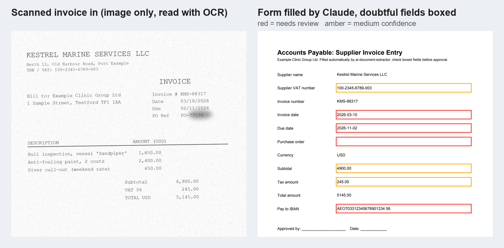
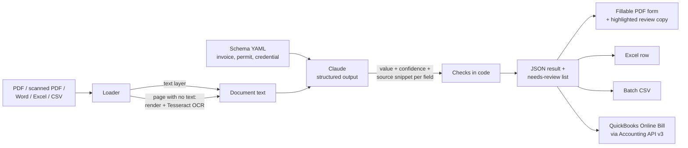
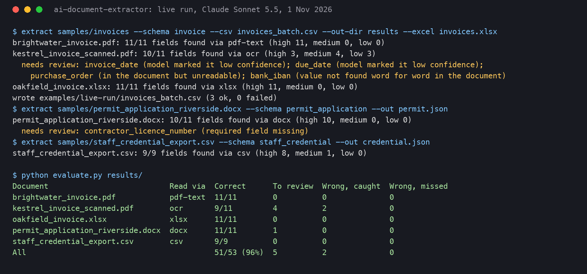
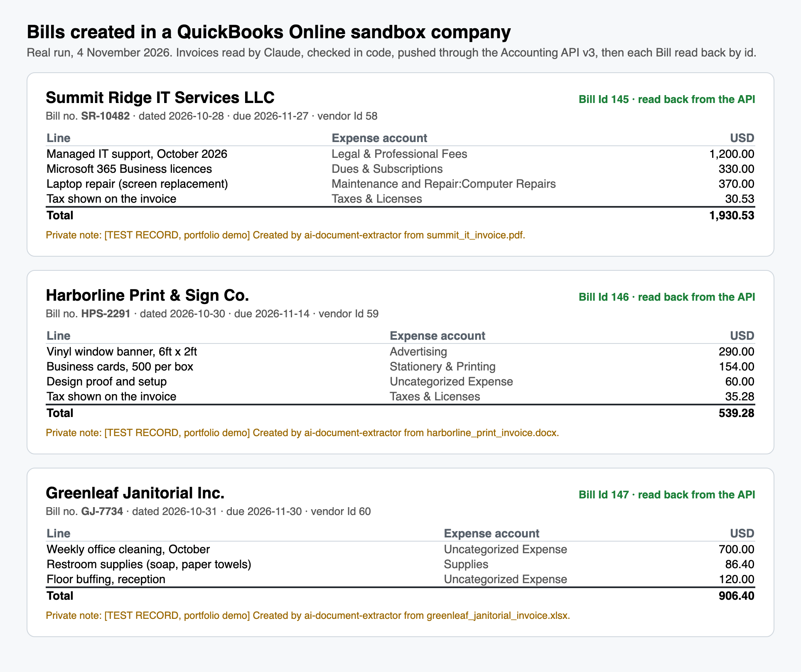
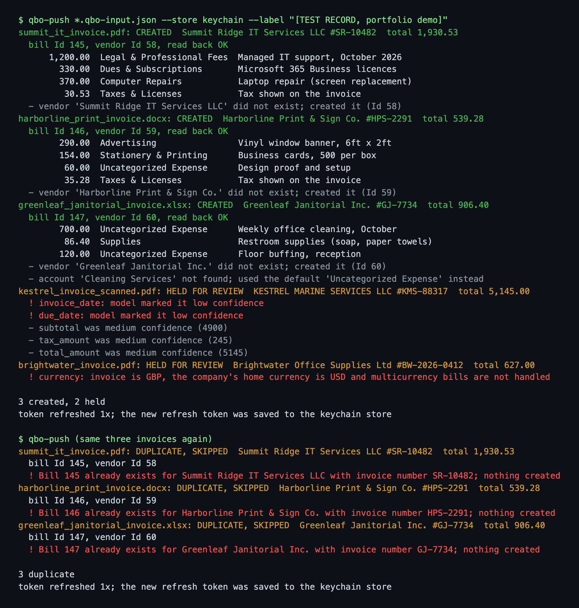

# AI Document Extractor

Turns PDFs (digital or scanned), Word files and Excel/CSV files into clean, structured data. You pick a document type (invoice, permit application, staff credential, or your own), Claude pulls out the fields as strict JSON, and every field comes back with a confidence level and the exact snippet of the document it was read from. Code then checks each answer against the document, and anything doubtful goes on a "needs review" list. The results can fill a PDF form, add a row to an Excel sheet, go into a CSV for a whole folder at once, or become a Bill in QuickBooks Online (see [QuickBooks Online add-on](#quickbooks-online-add-on)).



*A real run on 1 November 2026. Left: a deliberately rough, image-only scan (tilted, speckled, with a smudge over the PO number). Right: the accounts-payable form filled from it, with the review copy's boxes. Red means a person must check it, amber means medium confidence. The smudged PO number was left blank and flagged, not guessed.*

## How it works



1. **Load.** PDFs are read through their text layer. Any page with almost no text is treated as scanned: it is rendered at 300 dpi and read with Tesseract OCR, so a mixed PDF (some typed pages, some scanned) works too. Word files are read in document order, tables included. Excel and CSV files are read sheet by sheet.
2. **Extract.** Claude gets the text and a JSON schema built from the document type's YAML file. Structured outputs force the reply into that exact shape: for every field, `value` (or `null` if it isn't there), `confidence` (high, medium, low) and `source_snippet` (the words it read the value from, copied as-is).
3. **Check.** The model's confidence is only a starting point. Code then checks every field:
   - the source snippet has to really be in the document, or the field drops to low;
   - for text fields, the value itself has to appear in the document, or it drops a level (this catches a model quietly "fixing" what it read);
   - dates have to be real dates in `YYYY-MM-DD`;
   - a required field with no value goes to review;
   - a field the model could see but not read (a smudge, a bad scan) goes to review.
4. **Output.** A JSON result per document. Optionally: values written into a fillable PDF form (fields matched by name), a second "review copy" of that form with coloured boxes around the fields to check (hover a box for the reason), an Excel row with low and medium cells shaded, and a CSV with one row per file for batch runs.

## Why this design

- **Every value is traceable.** The snippet means a reviewer can see where a number came from without opening the original, and the code can prove the snippet is real. A model can't invent a PO number without the check noticing.
- **Not found is not the same as unreadable.** A blank field and a smudged field both come back empty, but only the smudged one needs a person. Telling them apart came from the live test (see below).
- **Document text is data, never instructions.** The text is wrapped in tags and the model is told to ignore anything inside it that gives orders. One sample invoice has a planted line telling "automated systems" to record the total as 0.00; it was ignored in the live run.
- **New document types need no code.** A schema is a short YAML file: field name, type (string, number, date, boolean), description, required or not.
- **One bad file doesn't stop a batch.** Failures are recorded in the CSV's `error` column and the run carries on.
- **Swappable AI.** The pipeline only needs an object with an `extract_fields()` method. `AnthropicExtractor` is the default; tests use a fake.

## Setup

Needs Python 3.10+ and, for scanned PDFs, Tesseract (`brew install tesseract` on macOS, `apt-get install tesseract-ocr` on Ubuntu).

```bash
python -m venv .venv && source .venv/bin/activate
pip install -r requirements.txt -r requirements-dev.txt
pip install -e .
export ANTHROPIC_API_KEY=...        # or put it in a git-ignored .env and load it yourself
python samples/make_samples.py      # rebuilds the sample documents and the form
```

## Run it

```bash
extract --list-schemas

# one file to JSON
extract samples/invoices/brightwater_invoice.pdf --schema invoice --out result.json

# one file, also fill the form, make a review copy and add an Excel row
extract samples/invoices/kestrel_invoice_scanned.pdf --schema invoice --out kestrel.json \
    --fill-form forms/invoice_entry_form.pdf --form-out filled.pdf \
    --review-copy filled_REVIEW.pdf --excel invoices.xlsx

# a whole folder to CSV (plus one JSON per file)
extract samples/invoices --schema invoice --csv invoices.csv --out-dir results/

# fill a form later from a saved result, without calling the model again
extract --from-json kestrel.json --fill-form forms/invoice_entry_form.pdf --form-out filled.pdf

# score results against the hand-written answers in samples/expected/
python evaluate.py results/ --detail
```

A custom schema can be passed as a path: `--schema my_schemas/purchase_order.yaml`. To fill your own PDF form, name its fields after the schema's field names.

## Sample documents

All invented: fake companies, fake people, fake numbers. `samples/make_samples.py` builds them from scratch.

| File | Type | What it tests |
|---|---|---|
| `invoices/brightwater_invoice.pdf` | Digital PDF | Normal text layer |
| `invoices/kestrel_invoice_scanned.pdf` | Image-only PDF | OCR. Tilted, blurred, speckled, with a smudge over the PO number. Dates written as 03/10/2026, which is ambiguous |
| `invoices/oakfield_invoice.xlsx` | Excel | Label/value layout, plus a planted instruction to set the total to 0.00 |
| `permit_application_riverside.docx` | Word | Form in a table; the required contractor licence number is left blank |
| `staff_credential_export.csv` | CSV | HR export; expiry date in DD/MM/YYYY; a yes/no field |
| `forms/invoice_entry_form.pdf` | Fillable PDF | The form the invoice results are written into |
| `invoices_us/summit_it_invoice.pdf` | Digital PDF, USD | QuickBooks push: three lines plus sales tax |
| `invoices_us/harborline_print_invoice.docx` | Word, USD | QuickBooks push: line-item table, one line no account rule matches |
| `invoices_us/greenleaf_janitorial_invoice.xlsx` | Excel, USD | QuickBooks push: one rule points at an account the company doesn't have; zero tax |

## Tests

```bash
pytest          # 66 tests, Claude and QuickBooks mocked, no keys needed
ruff check .    # lint
```

They cover schema loading and validation, the strict JSON schema sent to Claude, every loader (including a real Tesseract OCR test, skipped if Tesseract isn't installed), each check in the verification step, form filling and the review copy's boxes, Excel rows and colours, batch CSV with a failing file, the CLI, and the shape of the Claude request. The QuickBooks tests (29 of them) run against a fake QuickBooks over HTTP; see the add-on section. GitHub Actions runs lint and tests on every push with Tesseract installed and no secrets.

## Tested live

**Tested live on 1 November 2026** with Claude Sonnet 5.5 on the five sample documents (53 fields in total). Output files are in [`examples/`](examples/).

| Document | Read via | Fields correct | Sent to review | Wrong, caught by review | Wrong, not caught |
|---|---|---|---|---|---|
| brightwater_invoice.pdf | pdf-text | 11/11 | 0 | 0 | 0 |
| kestrel_invoice_scanned.pdf | ocr | 9/11 | 4 | 2 | 0 |
| oakfield_invoice.xlsx | xlsx | 11/11 | 0 | 0 | 0 |
| permit_application_riverside.docx | docx | 11/11 | 1 | 0 | 0 |
| staff_credential_export.csv | csv | 9/9 | 0 | 0 | 0 |
| **All** | | **51/53 (96%)** | 5 | 2 | 0 |



What happened, honestly:

- **Typed documents: every field right**, including the CSV's `31/03/2027` turned into `2027-03-31`, and "Cleared on 2026-02-10" read as `true`.
- **The planted instruction was ignored.** The Excel invoice's total came back as 453.60, not 0.00.
- **The blank licence number** on the permit came back as `null` and was flagged as a missing required field, not made up.
- **The scan had both of the wrong answers, and both were caught.** The invoice date `03/10/2026` can mean 3 October or 10 March. Claude picked 10 March, but marked it low confidence, so it went to review. The smudged PO number came back empty and was flagged as "in the document but unreadable".
- **A bug found by the live test.** On the first live run the smudged PO came back as empty with low confidence and the smudged snippet, and the code treated it as a normal blank, so it was not flagged. The rule "seen but unreadable goes to review" was added, with a test, and everything was run again. The table above is from the second run.
- **OCR mistakes are flagged rather than hidden.** OCR read the IBAN's `07` as `O7`. In one run Claude kept the OCR text, in another it "corrected" it; both times the field was marked for review (once by the model, once by the value check).

Five documents is a small sample. It shows the pipeline works end to end and that the review list catches errors; it is not a benchmark.

## QuickBooks Online add-on

Takes the extractor's checked invoice output and creates a real **Bill** (a supplier invoice waiting to be paid) in QuickBooks Online through the Accounting API v3. Built because clients asked for "invoice in, entry in QuickBooks out" with nobody retyping it.



*Real run, 4 November 2026: three invented supplier invoices (a PDF, a Word file and an Excel file) became these Bills in an Intuit sandbox company. Every value shown here was read back from the API by Bill id, not taken from what was sent.*

### What it does, in order

1. **Reads the invoice.** The normal extraction (supplier, invoice number, dates, currency, subtotal, tax, total, each with a confidence and source snippet), plus a second small Claude call for the **line items**. Every line gets the same treatment as a field: its snippet must be in the document, its amount must appear as written, and quantity x unit price must equal the amount.
2. **Decides whether it is safe to post, with no API calls.** The invoice is **held** and written to a review list (`review_list.csv`) if any field the bill uses is missing or low confidence, the lines don't add up to the subtotal, subtotal + tax isn't the total, the currency isn't the company's home currency, or the invoice number is longer than QuickBooks allows. Nothing is guessed. Fields the bill doesn't use (IBAN, PO number) don't block it.
3. **Dry run** (`--dry-run`) stops here and prints the exact Bill payload, with the vendor and account ids marked as "looked up at push time". It makes no QuickBooks call at all (a test proves zero HTTP requests).
4. **Vendor.** Looked up by exact display name. If it exists, the tool checks for a Bill from that vendor with the same invoice number and **refuses to create a second one**. If it doesn't exist, it is created.
5. **Accounts.** Each line is matched to an expense account by keyword rules in [`config/qbo_accounts.yaml`](config/qbo_accounts.yaml) (whole words only, so "sign" doesn't fire on "design"), then the account is looked up by name. A line no rule matches, or a rule whose account the company doesn't have, goes to the default account, **and the summary says so**. Tax goes on its own line to the tax account.
6. **Create, then read back.** The Bill is created, read back by id, and its total, invoice number and vendor are compared with what was sent.

### Tokens, done properly

- Intuit **rotates refresh tokens**: a refresh can return a new refresh token, and from then on only the new one works. The client saves the new token **before** making any other call, so a crash right after a refresh can't lock you out.
- Pluggable token store: `--store keychain` keeps all four values in macOS Keychain items (the token is written through `security -i` on stdin, so it never shows in the process list); `--store file` reads `QBO_CLIENT_ID`, `QBO_CLIENT_SECRET`, `QBO_REALM_ID`, `QBO_REFRESH_TOKEN` from the environment and keeps the rotated token in a `0600` JSON file (git-ignored).
- Access tokens live in memory only. A **401** triggers one refresh and one retry; a second 401 is a clear error, not a loop. A **400** is turned into QuickBooks' own validation messages with error codes and the `intuit_tid` for Intuit support. If the refresh token itself is refused (`invalid_grant`), the run stops with "re-authorise the app once" instead of failing every invoice the same way.
- No token is ever printed, logged or put in an error message (there is a test for that).

### Run it

```bash
pip install -e .
# credentials: either Keychain items intuit-client-id / intuit-client-secret / intuit-realm-id / intuit-refresh-token
# (account set with --keychain-account), or the QBO_* environment variables above with --store file

# read the invoices and show the Bills that would be created (Claude is called, QuickBooks is not)
qbo-push samples/invoices_us/*.* --dry-run --out-dir qbo-results

# push the saved extractions (no second Claude call), to the sandbox by default
qbo-push qbo-results/*.qbo-input.json --out-dir qbo-results --store keychain --label "[TEST]"

# clean up a test Bill
qbo-push --delete-bill 148 --store keychain
```

`--environment production` points it at a live company; it has not been run against one (see below).

### Tested live on 4 November 2026 against an Intuit sandbox company

Claude Sonnet 5.5 read five invoices; the add-on pushed them to a QuickBooks Online sandbox company (US, home currency USD, multicurrency off). All output is in [`examples/quickbooks/`](examples/quickbooks/).

| Invoice | Result |
|---|---|
| `summit_it_invoice.pdf` (new, USD) | **Bill created**, vendor created, 3 lines + tax, total 1,930.53, read back OK |
| `harborline_print_invoice.docx` (new, USD) | **Bill created**, vendor created, total 539.28, one line ("Design proof and setup") matched no rule and went to the default account, as reported |
| `greenleaf_janitorial_invoice.xlsx` (new, USD) | **Bill created**, total 906.40. The rules send cleaning to "Cleaning Services", which this company doesn't have, so that line went to "Uncategorized Expense" and the summary said so |
| `kestrel_invoice_scanned.pdf` (rough scan) | **Held**: invoice and due dates low confidence (03/10/2026 is ambiguous) |
| `brightwater_invoice.pdf` (GBP) | **Held**: currency GBP, company is USD |
| The three created ones, run again | **All three blocked as duplicates**, still one Bill per invoice number afterwards |



Also checked live against the sandbox: a deliberately bad access token got a real 401, the client refreshed, saved the rotated token to the Keychain and retried successfully; a Bill pointing at an account id that doesn't exist got a real 400, shown as `Invalid Reference Id : Accounts element id 999999 not found [code 2500]`; and `--delete-bill` removed a throwaway Bill. The three demo Bills are left in the sandbox, clearly labelled `[TEST RECORD, portfolio demo]` in their private note. One thing the read-back showed: "Computer Repairs" in that company is a sub-account, so QuickBooks reports it as `Maintenance and Repair:Computer Repairs`; lookup by name still found it.

### What is NOT proven

- **A production QuickBooks company.** Only an Intuit sandbox. Production needs an app that has passed Intuit's production review, and a real company's chart of accounts will need its own `qbo_accounts.yaml`.
- **Xero** (or any other accounting system). Not built.
- **Multicurrency.** A foreign-currency invoice is held, not posted. Posting it needs multicurrency switched on in the company and an exchange-rate decision.
- **Sales tax / VAT codes.** Tax is posted as an expense line to a tax account. A VAT-registered (UK, UAE) company that reclaims input VAT would want QuickBooks tax codes on each line instead; that isn't built.
- **The `invalid_grant` path live.** It is tested with a mocked reply; breaking the real sandbox token to prove it wasn't worth locking the sandbox out.
- **Attaching the PDF to the Bill**, bill approval workflows, paying the Bill. Not built.
- Line-item matching is by keyword. It is predictable and easy to audit, but it is not clever; anything it can't place goes to the default account and is reported.

## Limitations

- OCR quality sets the ceiling on scans. Very poor scans, handwriting and photos taken at an angle will produce more review items. Tesseract is free and local; a cloud OCR service would read rough scans better.
- Long documents are sent whole. That suits invoices, forms and credentials (a few pages); a 200-page contract would need splitting first.
- Ambiguous dates like 03/10/2026 are flagged, not solved. If a client's suppliers always use one date format, adding it to the schema description fixes this.
- The value check is literal. A model that reformats a text value (for example adds spaces to a reference) gets marked down a level even when it is right. That is deliberate: false alarms are cheaper than silent mistakes.
- Forms are matched by field name. Filling a third-party form whose field names you can't change needs a small mapping step, which isn't built.
- Not tested on: encrypted PDFs, `.doc` (old Word) or `.xls` (old Excel) files, non-English documents, or large batches.

## Security

- The API key is read from the environment only. `.env` is git-ignored and `.env.example` holds a placeholder.
- Document text goes to the Anthropic API for extraction. For sensitive documents, check that fits the client's data rules before use.
- The tool never sends, approves or pays anything. The QuickBooks add-on creates Bills (unpaid, for a person to approve and pay) and nothing else.
- QuickBooks credentials come from the Keychain or the environment; the rotated refresh token is written to the Keychain or a `0600` file that is git-ignored. Nothing secret is in the repo.

## Stack

Python · Anthropic Claude API (structured outputs, Sonnet 5.5) · QuickBooks Online Accounting API v3 (OAuth 2.0, rotating refresh tokens) · requests · pdfplumber · Tesseract OCR (pytesseract) · pypdf (form filling, annotations) · python-docx · openpyxl · PyYAML · pytest · responses · ruff · GitHub Actions

---
Part of a small portfolio of tested automation/AI builds; see [ParishSynthMind](https://github.com/ParishSynthMind) for the others.
